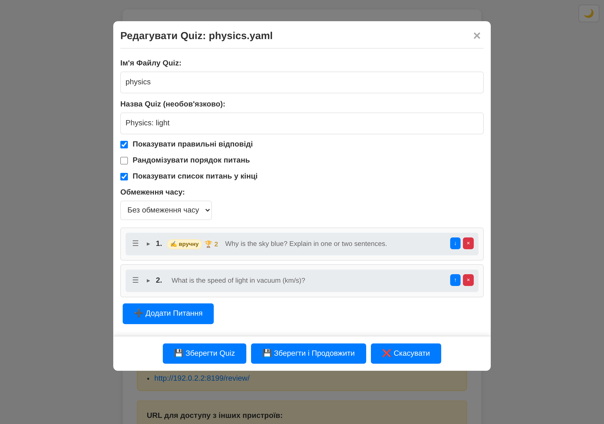
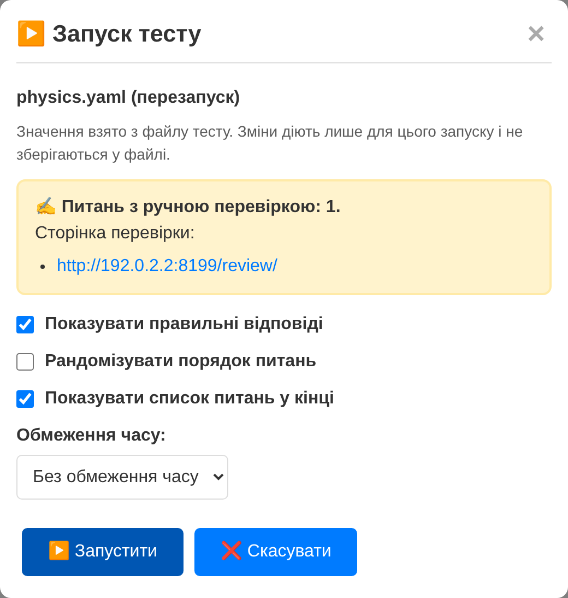
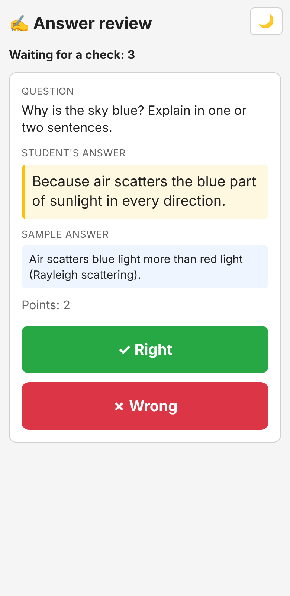
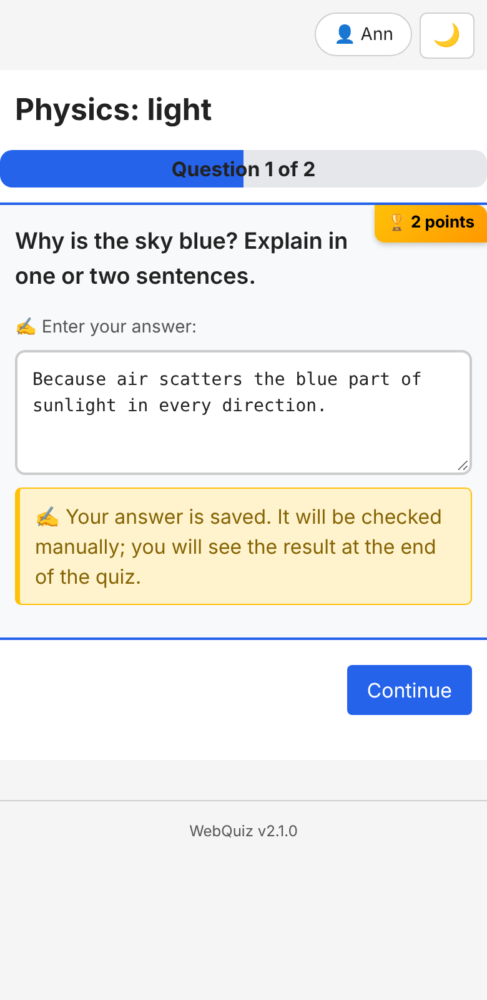
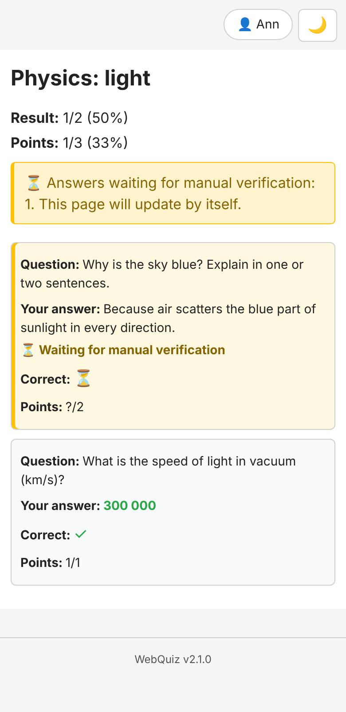
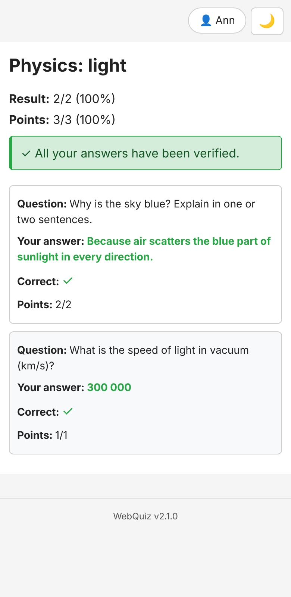
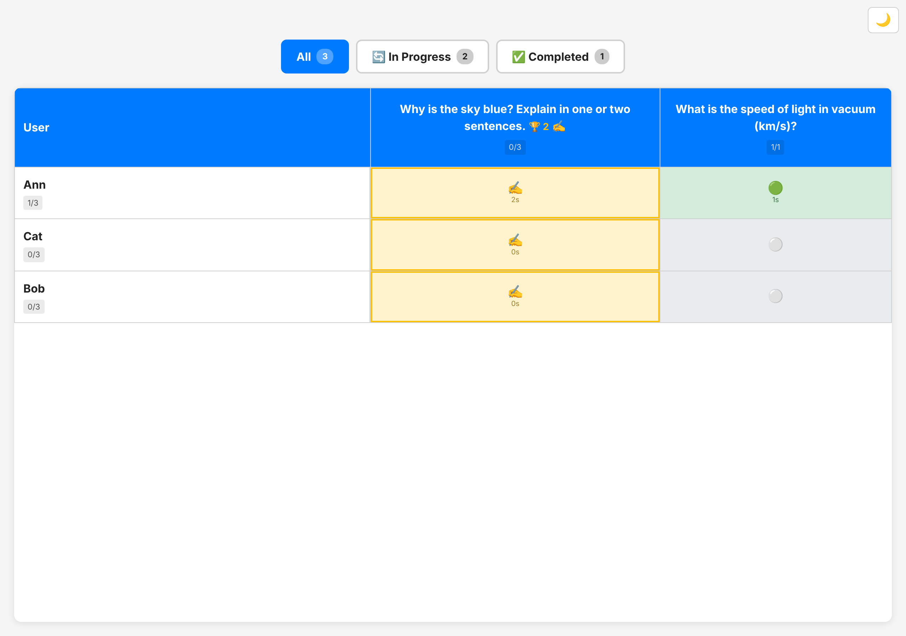

## WebQuiz 2.1.0

### ✍️ Answers checked by hand

Some answers cannot be checked by code: a short explanation, an opinion, an answer that can be written in many ways. Now a question can be **checked manually**. The student types the answer, and you mark it right or wrong on a page made for a phone. The same feature comes in WebQuiz 1.20 (Python), with the same quiz format.

```yaml
- question: "Why is the sky blue?"
  manual_check: true
  correct_value: "Because of Rayleigh scattering"   # optional: a sample answer, seen only on the review page
  points: 2
```

In the quiz editor, tick **"✍️ Ручна перевірка"** on a text question. Such questions carry the **"✍️ вручну"** mark in the question list.



**When you start the quiz,** the start pop-up says how many questions are checked manually and gives the address of the review page. While the quiz runs, the admin panel shows how many answers are waiting and warns when nobody is checking.



**The review page, `/review/`:**

- Open it on a phone in the same network. It uses the same master key as the admin panel; a new device asks for it once.
- It shows one answer at a time: the question, the student's answer and the sample answer. The student's name is never shown.
- Tap **✓ Right** or **✗ Wrong**, and the next answer appears.
- Several teachers can check at once: each phone gets a different answer. When all waiting answers are already open on other phones, a phone can **help** with one of them, and the first verdict counts.



**What the student sees:**

- After the answer: "Your answer is saved. It will be checked manually; you will see the result at the end of the quiz."
- On the results screen, answers that are not checked yet are marked in yellow, "⏳ Waiting for manual verification". The screen updates by itself every few seconds, so nobody needs to reload the page.







**Live stats** show a waiting answer as ✍️, and the question's column is marked with ✍️. In the answers CSV, `is_correct` stays empty until the answer is checked; then the file is written again with `True` or `False`.



Waiting answers are kept in memory: restarting the quiz or the server drops them, like the rest of the quiz progress.

### Downloads

WebQuiz comes in two versions of the same program. Take the **desktop version** for a teacher's computer: it shows an icon in the system tray. Take the **console version** for a server, a Raspberry Pi without a screen or the command line.

- **Desktop version**:
  - **Windows** (10 or newer): `webquiz-windows-setup.exe` (installer).
  - **macOS** (12 or newer): `webquiz-macos-app.zip` (`WebQuiz.app`, one app for Apple Silicon and Intel).
  - **Linux**: `webquiz-linux-desktop.zip` (64-bit PC, a desktop with a system tray).
- **Console version**:
  - **Windows** (10 or newer): `webquiz-windows.exe.zip` (portable).
  - **macOS** (12 or newer): `webquiz-macos-apple-silicon.zip` (M1 and newer) or `webquiz-macos-intel.zip`.
  - **Linux**: `webquiz-linux.zip` (64-bit PC), `webquiz-linux-arm64.zip` (Raspberry Pi 3, 4, 5 with a 64-bit system), `webquiz-linux-arm.zip` (older Raspberry Pi boards: Zero, 1, 2).
- **Documentation** as PDF: `webquiz-documentation-en.pdf` and `webquiz-documentation-uk.pdf`.

The `pip install webquiz` package is not published for 2.x. The Python version (1.x) stays at [oduvan/webquiz](https://github.com/oduvan/webquiz).

