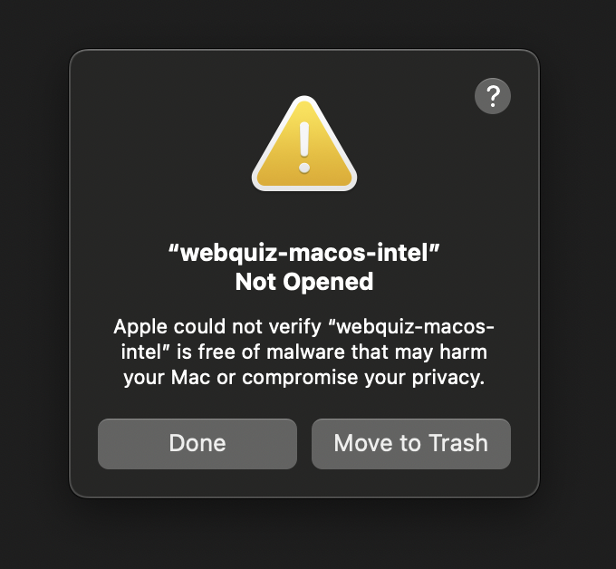
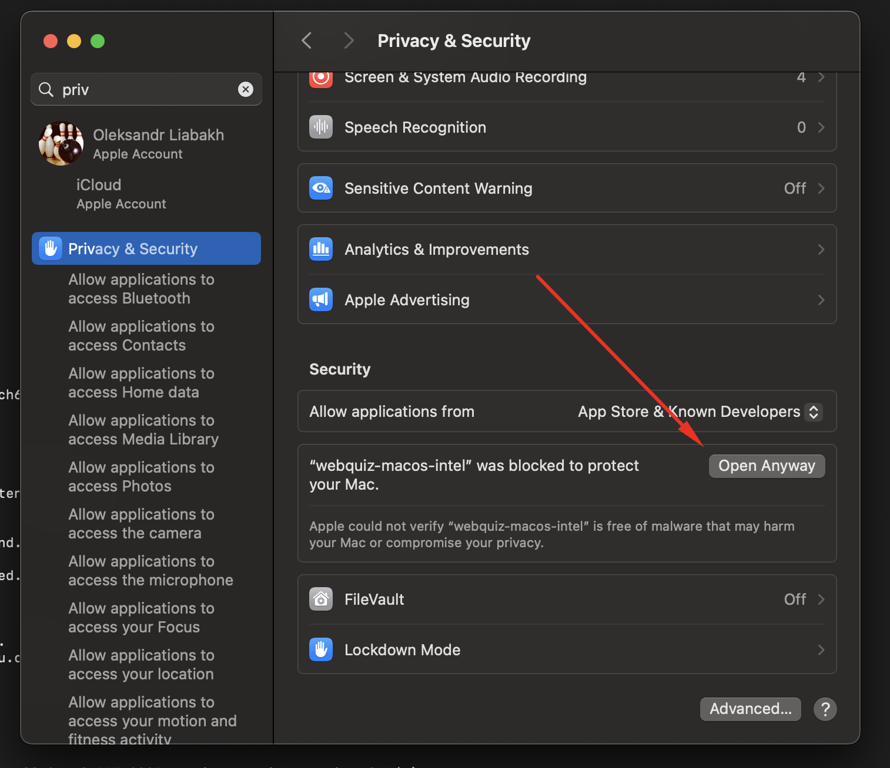
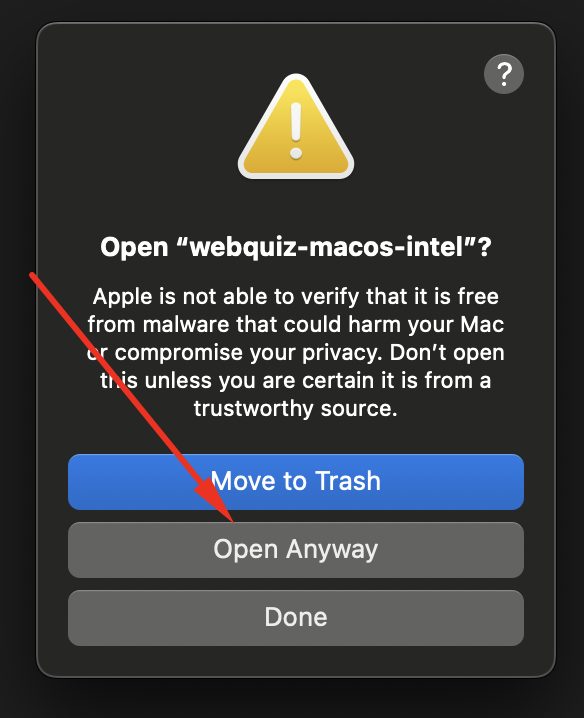
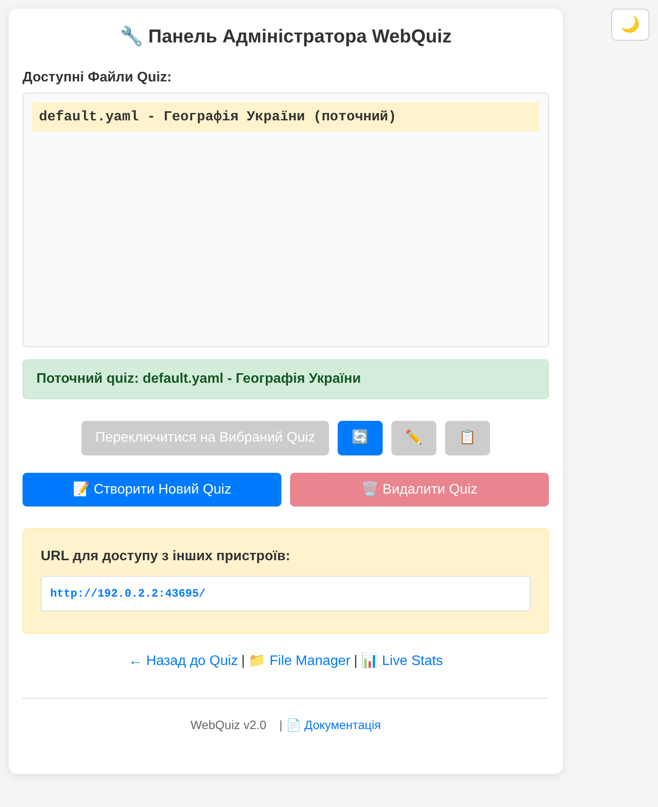
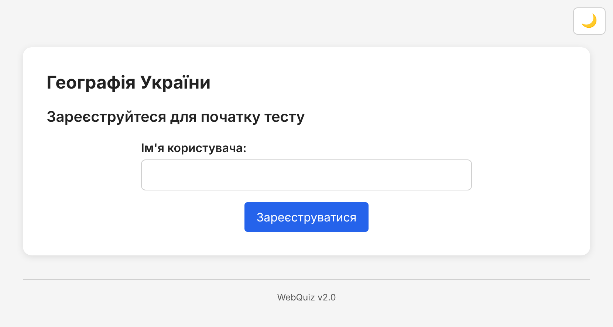
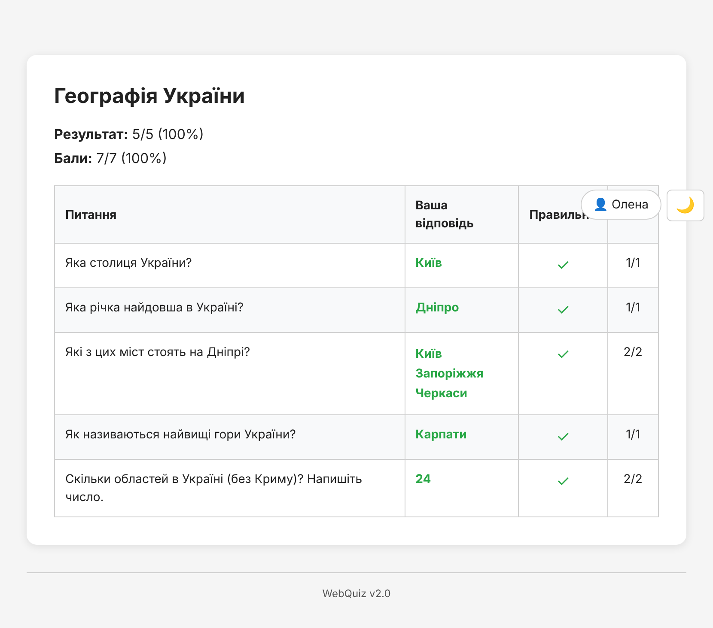

## First Run

This section will help you quickly launch **WebQuiz** in a local network.
The system is designed to work **inside your own network**, so you should not open its port to the public internet. This ensures that quiz results remain private and accessible only to users connected to your local environment.

---

### Download and Launch

The easiest way to start using **WebQuiz** is by running the prebuilt program. You do not need to install Python or anything else.

#### Two Versions: Desktop and Console

WebQuiz comes in two versions. Inside they are the same program. They differ in how you start and stop them.

- **Desktop version** — for a teacher's computer. WebQuiz puts its icon in the system tray (on macOS, in the menu bar at the top of the screen). The icon has a small menu to open the admin pages and to quit. There is no console window.
- **Console version** — for servers, a Raspberry Pi without a screen, and the command line. WebQuiz runs in a terminal window and stops with Ctrl+C.

If you are not sure, take the desktop version.

1. Go to the [Releases](https://github.com/oduvan/webquiz-go/releases) page on the project’s GitHub repository.
2. Download the file that matches your computer.

   **Desktop version:**
   - **Windows:** `webquiz-windows-setup.exe` (installer). Windows 10 or newer.
   - **macOS:** `webquiz-macos-app.zip` with `WebQuiz.app`. It is one app for all Macs: with an Apple chip (M1 and newer) and with Intel. macOS 12 or newer.
   - **Linux:** `webquiz-linux-desktop.zip` for a normal 64-bit computer. It needs a desktop with a system tray: KDE, XFCE, Cinnamon, MATE or Ubuntu. Plain GNOME shows tray icons only with the AppIndicator extension.

   **Console version:**
   - **Windows:** `webquiz-windows.exe.zip` (portable). Windows 10 or newer.
   - **macOS:** `webquiz-macos-apple-silicon.zip` for Macs with an Apple chip (M1 and newer), or `webquiz-macos-intel.zip` for older Intel Macs. macOS 12 or newer.
   - **Linux:** `webquiz-linux.zip` for a normal 64-bit computer, `webquiz-linux-arm64.zip` for a 64-bit Raspberry Pi (3, 4, 5), or `webquiz-linux-arm.zip` for older and smaller Raspberry Pi boards (Zero, 1, 2).
3. Start the program as described below for your version.

WebQuiz keeps all its files in the folder where the program lies (see [Files and Folders Created](#files-and-folders-created)). Put the program in its own folder, for example `WebQuiz`.

#### Start the Desktop Version

- **Windows:** run `webquiz-windows-setup.exe`, then start WebQuiz from the Start menu. The WebQuiz icon appears in the notification area, next to the clock. Windows may hide new icons behind the small arrow (**^**); you can drag the icon from there to the taskbar.
- **macOS:**
  1. Open `webquiz-macos-app.zip`. Finder unpacks it, and you get `WebQuiz.app`.
  2. Make a folder of its own for WebQuiz, for example `WebQuiz` in your `Documents` folder, and move `WebQuiz.app` into it with Finder. WebQuiz keeps its settings, quizzes and results next to `WebQuiz.app`, in this folder.
  3. The first time, right-click (or Control-click) `WebQuiz.app`, choose **Open**, and then click **Open** in the dialog. You need this only once, because the app is not signed by Apple. On macOS 15 and newer the dialog may have no **Open** button. Then use **System Settings → Privacy & Security → Open Anyway**, as shown in [Important for macOS Users](#important-for-macos-users).
  4. The WebQuiz icon, a check mark in a square, appears in the menu bar at the top of the screen. The app has no window and no icon in the Dock.

  If `WebQuiz.app` is in the Applications folder, or if macOS runs it from a hidden read-only copy, WebQuiz cannot keep its data next to the app. (macOS makes such a copy when you open the app right where it was unpacked, without moving it first.) WebQuiz then uses the folder `Documents/WebQuiz` in your home folder, and the second line of its menu shows this folder.
- **Linux:** unpack the archive, allow the file to run, and start it:
  ```
  unzip webquiz-linux-desktop.zip
  chmod +x webquiz-linux-desktop
  ./webquiz-linux-desktop
  ```
  In many file managers you can also start it with a double click. The icon appears in the system tray of the panel.

When the desktop version starts, it also opens the admin panel in your browser.

#### The Tray Menu

Click the WebQuiz icon to open its menu:

- The first line shows the version and the address that students open, for example `WebQuiz 2.0 — http://192.168.1.5:8080/`. When WebQuiz cannot start, this line shows the error instead. The most common one is a busy port: another program uses port 8080, very often a WebQuiz that already runs. The log file in the `logs/` folder has the details. On Windows a message box shows the error too.
- **Open admin panel**, **Open live stats** and **Open file manager** open these pages in your browser.
- **Quit** stops WebQuiz. Answers that are not saved yet are written to the CSV files first. Then the icon goes away.

The menu is in Ukrainian, or in English when `webquiz.yaml` has `language: en`.

The desktop version has no console window, so it shows no messages there. Its messages go to the log file in `logs/`. It has no background mode: with `-d` it runs as usual and says so in the log.

#### Start the Console Version

- **Windows (Portable):** extract `webquiz-windows.exe.zip`, then double-click the `.exe` file or run it from the command line.
- **macOS / Linux:** first allow the file to run. Use the real file name from the archive, for example:
  ```
  chmod +x webquiz-linux
  ```
  then start it:
  ```
  ./webquiz-linux
  ```

To stop the console version, press **Ctrl+C** in its window.

#### Important for macOS Users

On first launch on macOS, you may see a security warning, because the program is not signed by Apple. This happens with `WebQuiz.app` and with the console version:



To allow the application to run:

1. Click **Done** in the warning dialog
2. Open **System Settings** → **Privacy & Security**
3. Scroll to the **Security** section and click **Open Anyway**:



4. Confirm by clicking **Open Anyway** in the dialog:



WebQuiz will now launch normally. This is a one-time procedure — subsequent launches won't require confirmation.

#### Important for Windows Users

Windows Defender or other antivirus software may sometimes warn about the program, although it is safe. New programs that few people have downloaded yet are often flagged by mistake. This is called a false positive.

WebQuiz is open-source software. You can:
- Review the source code on [GitHub](https://github.com/oduvan/webquiz-go)
- Add the file to Windows Defender exclusions

If you see a warning, allow the program to run or add it to your antivirus's trusted applications list.

---

After launching, the admin panel page opens in your browser at [http://localhost:8080/admin/](http://localhost:8080/admin/):



The admin panel shows:
- The list of available quizzes with the current quiz highlighted
- Buttons to switch, edit, duplicate, or delete quizzes
- The local network URL for other devices to connect
- Quick links to **File Manager** and **Live Stats** at the bottom
- The current WebQuiz version and a link to the documentation
- A theme switcher (sun/moon icon) in the top-right corner for dark/light mode

---

### Files and Folders Created

After the first launch, WebQuiz will automatically create several service files and folders in the same directory as the executable. For `WebQuiz.app` on macOS, this is the folder that holds `WebQuiz.app`.
They are used to store configuration, results, and diagnostic information.

| File / Folder | Purpose |
|---------------|----------|
| **webquiz.yaml** | The main configuration file. Stores system parameters, including user registration settings and general options. |
| **quizzes/** | Directory for storing quizzes in YAML format. You can create your own question files or edit the default example that comes included. Pictures go to `quizzes/imgs/` and files for download go to `quizzes/attach/`. |
| **data/** | Quiz results in CSV format will be stored here. They can be viewed or opened in spreadsheet editors. |
| **logs/** | Directory containing application logs. Records messages about launches, errors, or warnings. If something goes wrong during testing, these files will help identify the cause. |
| **static/** | Contains the quiz page that students see. Typically, you don't need to edit these files. |

To keep these files in another folder, set the environment variable `WEBQUIZ_BINARY_DIR` to that folder before you start the program.

---

### The First Quiz

Right after the first run, WebQuiz automatically creates a simple example quiz.
This allows you to immediately test the system without any additional configuration.

To take the quiz:

1. Open [http://localhost:8080](http://localhost:8080) in your browser.



2. Enter your name (or any test name if you're just checking functionality).
3. Click the **Register** button — the system will load the example quiz from the configuration file, and you can complete it like a normal user.
4. After finishing the quiz, open the **data** folder — you'll find a file with the results in CSV format. If needed, also check the **logs** folder to ensure the server is running without errors.



#### If the Connection Drops

Wi-Fi in a classroom is not always stable. When the student's device loses the connection to the server, the quiz page does not show an error. It shows a yellow banner at the top, **"Connection to the server lost. Retrying..."**, and keeps repeating the request every few seconds until the server answers. The chosen answer is locked while the page waits, and the quiz continues on its own once the connection is back.

An answer or a registration is never counted twice, even if the server got the first attempt and only the reply was lost. A page opened or reloaded while the server is unreachable also waits for the connection instead of showing the registration form again.

---

### Build from Source and Command-Line Options

If you want to build WebQuiz yourself, you need Go and Node.js:

```
git clone https://github.com/oduvan/webquiz-go.git
cd webquiz-go
make build
./bin/webquiz
```

`make build-desktop` builds the desktop version as `bin/webquiz-desktop`.

Additional command-line options:
- `--config` — specify a custom configuration file path.
- `--port` — the port to listen on (default: 8080).
- `--master-key` — the master key for the admin panel.
- `--quizzes-dir` — the folder with quiz files.
- `--csv-dir` — define a custom location for saving results.
- `--logs-dir` — change the folder of the log files.
- `-d` or `--daemon` — run the server in background mode (console version only, not on Windows).
- `--stop`, `--status` — stop or check the status of the server.
- `--version` — print the version and exit.

These capabilities will come in handy if you want to use WebQuiz as part of a larger system or automatically start it when your device boots.
