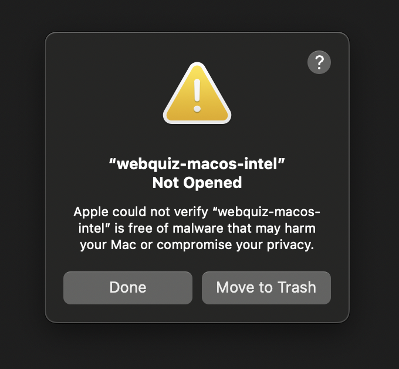
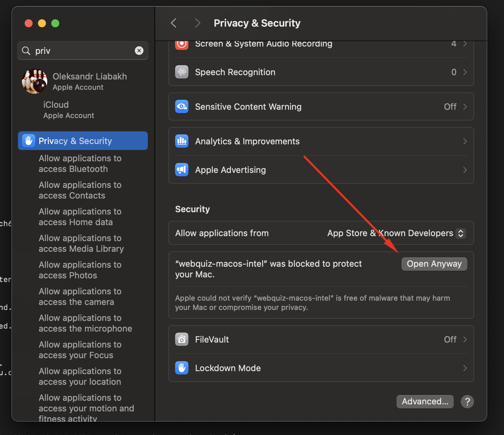
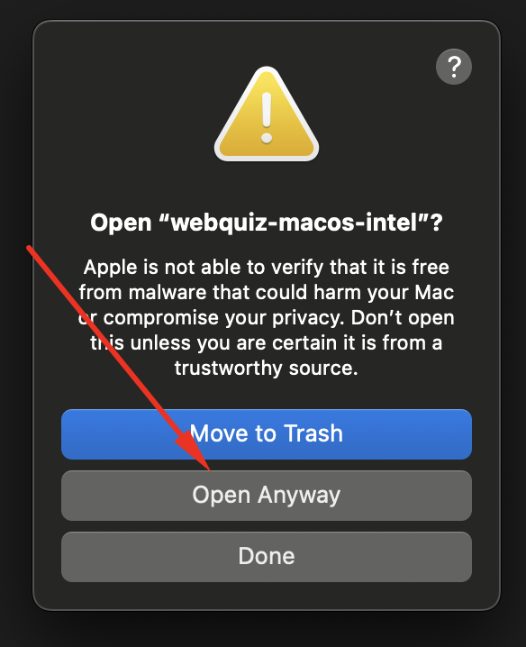
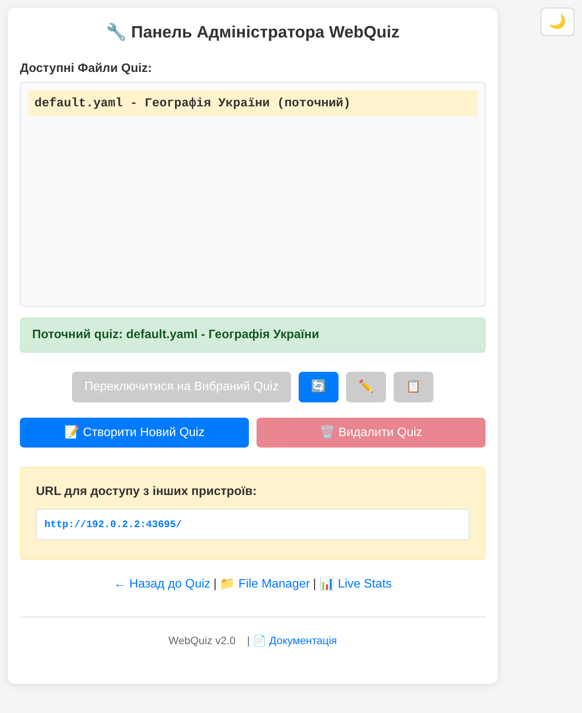
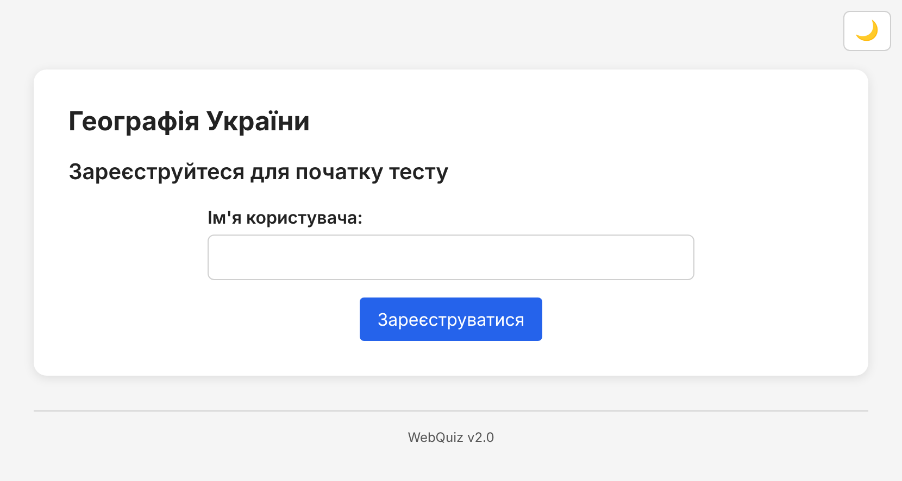
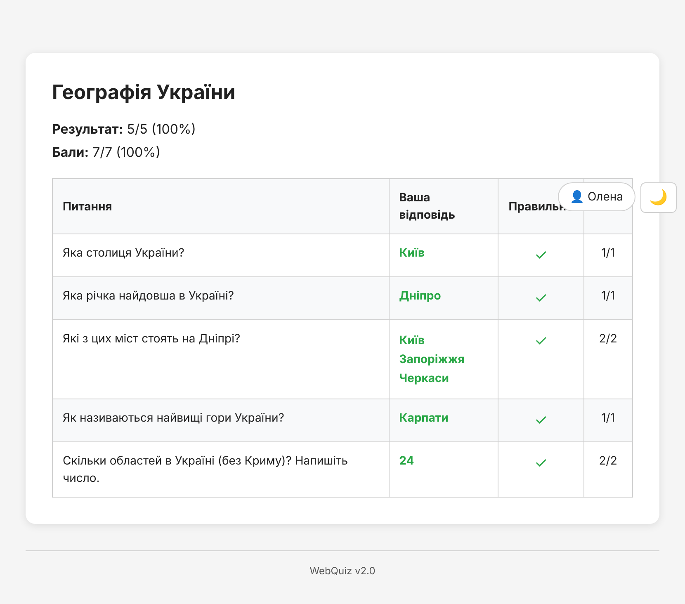

## Перший запуск

Цей розділ допоможе швидко запустити **WebQuiz** у локальній мережі.
Система створена для роботи **всередині вашої мережі**, тому не варто відкривати порт у публічний інтернет. Це гарантує, що результати тестів залишаться приватними й доступними лише тим, хто підключений до локальної мережі.

---

### Завантаження та запуск

Найпростіший спосіб почати роботу з **WebQuiz** — це використати готову програму. Це один файл. Встановлювати Python чи щось інше не потрібно.

1. Перейдіть на сторінку [Releases](https://github.com/oduvan/webquiz-go/releases) у GitHub-репозиторії проєкту.
2. Завантажте файл, який підходить вашому комп'ютеру:
   - **Windows:** `webquiz-windows-setup.exe` (інсталятор) або `webquiz-windows.exe.zip` (портативна версія). Windows 10 або новіша.
   - **macOS:** `webquiz-macos-apple-silicon.zip` для Mac з чипом Apple (M1 і новіші) або `webquiz-macos-intel.zip` для старіших Mac з Intel. macOS 12 або новіша.
   - **Linux:** `webquiz-linux.zip` для звичайного 64-бітного комп'ютера, `webquiz-linux-arm64.zip` для 64-бітного Raspberry Pi (3, 4, 5) або `webquiz-linux-arm.zip` для старіших і менших плат Raspberry Pi (Zero, 1, 2).
3. Якщо файл постачається у вигляді архіву, розпакуйте його у будь-яку зручну папку.
4. Запустіть програму:
   - **Windows (Інсталятор):** запустіть `webquiz-windows-setup.exe` та відкрийте WebQuiz з меню Пуск.
   - **Windows (Портативна версія):** розпакуйте `webquiz-windows.exe.zip`, потім двічі клацніть на файлі `.exe` або запустіть його з командного рядка.
   - **macOS / Linux:** спочатку дозвольте виконання файлу. Використайте справжню назву файлу з архіву, наприклад:
     ```
     chmod +x webquiz-linux
     ```
     після чого запустіть:
     ```
     ./webquiz-linux
     ```

WebQuiz зберігає всі свої файли в папці, де лежить програма (див. [Створені файли та папки](#створювані-файли-та-папки)). Покладіть програму в окрему папку, наприклад `WebQuiz`.

#### Важливо для macOS користувачів

При першому запуску на macOS ви побачите попередження безпеки, оскільки бінарний файл не підписаний Apple:



Щоб дозволити запуск:

1. Натисніть **Done** у попередженні
2. Відкрийте **System Settings** (Налаштування системи) → **Privacy & Security** (Конфіденційність та безпека)
3. Прокрутіть до розділу **Security** та натисніть **Open Anyway**:



4. Підтвердіть, натиснувши **Open Anyway** у діалозі:



Тепер WebQuiz запуститься нормально. Це одноразова процедура — наступні запуски не потребуватимуть підтвердження.

#### Важливо для Windows користувачів

Windows Defender або інший антивірус іноді може попереджати про програму, хоча вона безпечна. Нові програми, які мало людей завантажило, часто позначають помилково. Це називається хибним спрацюванням.

WebQuiz — це програмне забезпечення з відкритим вихідним кодом. Ви можете:
- Перевірити вихідний код на [GitHub](https://github.com/oduvan/webquiz-go)
- Додати файл до винятків Windows Defender

Якщо ви бачите попередження, дозвольте запуск програми або додайте її до списку довірених додатків у вашому антивірусі.

---

5. Після запуску у вашому браузері відкриється сторінка адмін-панелі [http://localhost:8080/admin/](http://localhost:8080/admin/):



Адмін-панель показує:
- Список доступних тестів з виділеним поточним тестом
- Кнопки для перемикання, редагування, дублювання або видалення тестів
- URL локальної мережі для підключення інших пристроїв
- Швидкі посилання на **File Manager** та **Live Stats** внизу
- Поточну версію WebQuiz та посилання на документацію
- Перемикач теми (іконка сонце/місяць) у правому верхньому куті для темного/світлого режиму

---

### Створювані файли та папки

Після першого запуску у тій самій директорії, де знаходиться виконуваний файл, WebQuiz створить кілька службових файлів і папок. Вони потрібні для збереження налаштувань, результатів та діагностики:

| Файл / папка | Призначення |
|---------------|--------------|
| **webquiz.yaml** | Головний конфігураційний файл. Зберігає параметри системи, включаючи налаштування реєстрації користувачів і загальні опції. |
| **quizzes/** | Папка для збереження тестів у форматі YAML. Ви можете створювати власні файли з питаннями або редагувати приклад, що додається за замовчуванням. Зображення лежать у `quizzes/imgs/`, а файли для завантаження — у `quizzes/attach/`. |
| **data/** | Тут зберігатимуться результати тестування у форматі CSV. Їх можна переглядати або відкривати у табличних редакторах. |
| **logs/** | Папка з журналами роботи програми. У ній фіксуються повідомлення про запуски, помилки або попередження. Якщо під час тестування щось піде не так, саме ці файли допоможуть знайти причину. |
| **static/** | Містить сторінку тесту, яку бачать студенти. Зазвичай редагувати ці файли не потрібно. |

Щоб тримати ці файли в іншій папці, перед запуском програми задайте змінну середовища `WEBQUIZ_BINARY_DIR` з цією папкою.

---

### Перший тест

Одразу після запуску WebQuiz автоматично створює приклад простого тесту.
Він потрібен, щоб користувач міг одразу перевірити роботу системи без додаткових налаштувань.

Щоб пройти тест:

1. Відкрийте адресу [http://localhost:8080](http://localhost:8080) у браузері.



2. Уведіть своє ім’я (або будь-яке тестове ім’я, якщо ви просто перевіряєте роботу).
3. Натисніть кнопку **Зареєструватися** — система завантажить приклад тесту з файлу конфігурації, і ви зможете пройти його як звичайний користувач.
4. Після завершення тесту відкрийте папку **data** — там ви знайдете файл із результатами у форматі CSV. Якщо потрібно, перегляньте також журнали у папці **logs**, щоб переконатися, що сервер працює без помилок.



#### Якщо зникло з'єднання

Wi-Fi у класі не завжди стабільний. Коли пристрій учня втрачає з'єднання з сервером, сторінка тесту не показує помилку. Вгорі з'являється жовта смуга **«Немає з'єднання з сервером. Повторна спроба...»**, і сторінка повторює запит кожні кілька секунд, доки сервер не відповість. Поки сторінка чекає, обрану відповідь змінити не можна, а коли з'єднання повертається, тест продовжується сам.

Відповідь чи реєстрація ніколи не зараховується двічі, навіть якщо сервер отримав першу спробу і загубилася лише відповідь сервера. Сторінка, яку відкрили чи перезавантажили, поки сервер недоступний, теж чекає на з'єднання, а не показує знову форму реєстрації.

---

### Збирання з вихідного коду та параметри командного рядка

Якщо ви хочете зібрати WebQuiz самі, вам потрібні Go та Node.js:

```
git clone https://github.com/oduvan/webquiz-go.git
cd webquiz-go
make build
./bin/webquiz
```

Додаткові параметри командного рядка:
- `--config` — вказує шлях до власного конфігураційного файлу.
- `--port` — порт, який слухає сервер (за замовчуванням: 8080).
- `--master-key` — головний ключ для адмін-панелі.
- `--quizzes-dir` — папка з файлами тестів.
- `--csv-dir` — задає інше місце для збереження результатів.
- `--logs-dir` — змінює папку з файлами журналів.
- `-d` або `--daemon` — запуск у фоновому режимі (не на Windows).
- `--stop`, `--status` — зупинка або перевірка стану сервера.
- `--version` — показує версію й завершує роботу.

Ці можливості стануть у пригоді, якщо ви хочете використовувати WebQuiz як частину більшої системи або запускати його автоматично при старті пристрою.
